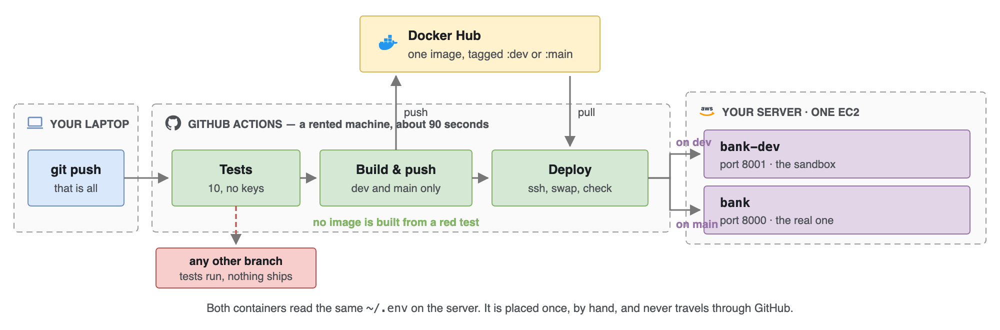

# BuildrBank · ship it without typing

Last week you put this agent on the internet by hand. Eleven commands —
build, tag, push, `ssh`, pull, run. It worked.

Do that five times a day and one day you will skip one.

This repo is the same project with one thing added: a file that writes those
eleven commands down, so a machine types them instead of you.

Nothing about the application changes. Same image, same server, same Docker
Hub, same commands. Only the typist changes.

```
push to any branch ──▶ test                                     stops here
push to dev        ──▶ test ──▶ build & push ──▶ deploy to :8001
push to main       ──▶ test ──▶ build & push ──▶ deploy to :8000
```

One server, two slots. `dev` lands in a sandbox container on port 8001,
`main` lands in the real one on port 8000. Any other branch gets the tests
and nothing else — that is what makes a branch a safe place to be wrong.



> **Doing this for the first time?** [`STEPS.md`](STEPS.md) is the same
> journey as a numbered checklist — nineteen steps, every command written
> out. This file explains *why*; that one tells you *what to type*.

---

## Before you start

| | |
|---|---|
| **Your `.env` from Week 5** | same keys, same Supabase project. Nothing to redo. |
| **GitHub** | Actions is free and unlimited on public repos |
| **Docker Hub** | the image you pushed last week is still sitting there |
| **AWS** | we build a fresh server today |

Lost your `.env`, or starting clean? Do
[Starting from scratch](#starting-from-scratch) first — five steps, about
twenty minutes — then come back here.

---

## 1 · Fork it

Actions only runs in a repo you own. **Fork**, top right of this page.

Clone it next to your Week 05 folder — the `cp` below is simpler that way:

```bash
git clone https://github.com/YOUR-NAME/buildrbank-cicd.git
cd buildrbank-cicd
cp ../buildrbank-deploy/.env .env        # the one file that is never in git
```

If Week 05 lives somewhere else, use the full path — and quote it if any
folder name has a space in it, or the shell splits the path and you get
`cp: .env: Not a directory`:

```bash
cp "/Users/you/My Documents/buildrbank-deploy/.env" .env
```

Prove it still works before you change anything:

```bash
python3 -m venv .venv
source .venv/bin/activate                # Windows: .venv\Scripts\activate
python -m pip install -r requirements.txt -r requirements-dev.txt
python scripts/check.py
```

**Checkpoint —** six green ticks.

> `pip` errors about building wheels? Your Python is newer than the 3.12 the
> container uses. Install 3.12 and run `python3.12 -m venv .venv` instead.

---

## 2 · One server, two slots

### Launch it

EC2 → **Launch instance**.

| | |
|---|---|
| Image | Ubuntu, 64-bit **x86** |
| Size | `t3.micro` |
| Key pair | download the `.pem` — you only get it once |
| Firewall | allow **22**, **8000** and **8001**, source **Anywhere-IPv4** |

Three ports, not two. `8000` is production and `8001` is the dev sandbox;
[step 6](#6--change-something-and-watch-it-ship) is where you meet both.

That firewall setting is wider than last week's. [Step 3](#3--why-port-22-is-open-to-everyone)
explains why it has to be, and what it costs.

### The address

Copy the **Public IPv4 address** from the Instances page. That goes in `ssh`,
in your browser, and in the `EC2_HOST` secret.

> **Do not stop the instance.** A stopped instance hands its address back,
> and starting it again gets you a different one — at which point the
> pipeline keeps deploying to an address that is no longer yours, and the
> error will look nothing like "the IP changed". If it happens anyway, it is
> not fatal: put the new number in `EC2_HOST` and push again.

### Walk in and install Docker

```bash
chmod 400 builder-bank.pem
scp -i builder-bank.pem .env ubuntu@YOUR-IP:~
ssh -i builder-bank.pem ubuntu@YOUR-IP

curl -fsSL https://get.docker.com | sudo sh
sudo usermod -aG docker ubuntu                 # then log out and back in
chmod 600 ~/.env
```

**Checkpoint —** `docker ps` runs without `sudo`.

### Start it once, by hand

Your image from last week is still on Docker Hub. You do not need to build
anything to get back on the air:

```bash
docker login
docker run -d --name bank --restart unless-stopped -p 8000:8000 --env-file ~/.env YOUR-NAME/buildrbank:v1
```

**Checkpoint —** `http://YOUR-IP:8000` answers.

> `not found` on the pull? Your Week 05 image may carry a different tag.
> Open `hub.docker.com/r/YOUR-NAME/buildrbank/tags` and use whatever is
> listed — any image of this app will do, because the pipeline replaces it.

That is the last time you type any of this.

---

## 3 · Why port 22 is open to everyone

Last week the rule said source **My IP** — yours, and nobody else's.

GitHub's build machines are not yours, and they do not have *an* address.
Actions runs on thousands of IPs that change constantly. There is no narrow
rule that lets them in, so the rule has to be **Anywhere-IPv4** (`0.0.0.0/0`).

Now say what that costs, out loud. Port 22 is reachable from every machine
on earth, and scanners find open ports within hours. The only thing between
them and your server is the key file you downloaded once. This image has
password login switched off, so that key is not one lock among several —
it is the lock. Two things follow:

- the `.pem` on your laptop is a serious credential now. Treat it like one.
- terminate the instance when the course ends, the way you would close an account.

The grown-up fix is to keep 22 shut and let the pipeline open it for its own
address, just long enough to deploy, then shut it again. That needs an AWS
user for the pipeline and two more secrets. It is the right answer for
anything real, and it is not what we are doing today.

---

## 4 · Three secrets and one variable

**Settings → Secrets and variables → Actions → New repository secret.**

| Name | Where it comes from |
|---|---|
| `DOCKERHUB_TOKEN` | Docker Hub → Account settings → Personal access tokens → Generate. **Not your password.** |
| `EC2_HOST` | your server's address. Just the number — no `http://`, no `:8000` |
| `EC2_SSH_KEY` | the whole key file. `cat builder-bank.pem`, copy **everything**, including the `-----BEGIN` and `-----END` lines |

> `EC2_SSH_KEY` is where this goes wrong most often, and all three failures
> produce an error that names something else.
>
> 1. **The `%` at the end.** Your terminal prints a `%` (or `⏎`) right after
>    `-----END RSA PRIVATE KEY-----`. That is the shell saying the file has
>    no final newline. It is **not part of the key** — do not copy it.
> 2. **The missing newline it is telling you about.** After pasting into the
>    secret box, **press Enter once**, so the cursor sits on an empty line
>    below `-----END`. A key that stops dead on the last dash reads as
>    `ssh: no key found`.
> 3. **The `-----END` line itself.** Stopping one line short gives you
>    `invalid format`.
>
> If you have an editor open, open the `.pem` as a file and use
> `Cmd/Ctrl+A`, `Cmd/Ctrl+C` instead. You cannot miss a line that way.

Now the **Variables** tab, right next to Secrets on the same page:

| Name | Value |
|---|---|
| `DOCKERHUB_USER` | your Docker Hub username |

Your username is not on the secrets list, and that is the lesson. It is
printed on every image you have ever pushed, and GitHub will show it back
to you any time you ask. A token you paste once and can never read again.
Two tabs, one page — GitHub built the distinction into the furniture.

> Until `DOCKERHUB_USER` is set, the build and deploy jobs **skip** rather
> than fail. That is why a freshly forked repo shows a green tick and two
> greyed-out boxes instead of a red cross.

The agent's own keys — OpenRouter, Supabase, Langfuse — are not on that list
either. They stay in `~/.env` on the server. The pipeline never calls a
model, so it never needs a model key.

---

## 5 · Fill in the five TODOs

Open [`.github/workflows/pipeline.yml`](.github/workflows/pipeline.yml).
Five lines say `TODO`, each with a sentence of reading above it.

| | What goes there |
|---|---|
| 1 | the name of the secret holding your Docker Hub token |
| 2 | a second image tag — the commit's own id |
| 3 | the name of the secret holding your server's address |
| 4 | the name of the secret holding your key |
| 5 | production's port mapping |

TODO 5 is a question, not a copy. `deploy-dev` just above it says
`-p 8001:8000`. The number on the left is the door on the server; the number
on the right is the port the app listens on inside the container, and that
never changes. dev answers on 8001 — so which door does production answer on?

Commit and push. The first run will probably be red. Open it, read the log,
find the line. That is the skill.

---

## 6 · Change something, and watch it ship

```bash
git switch -c dev
```

Open `app/index.html`. Near the top is the page's palette. Find every line
that says `--ground:` — **there are three**, because the page has a light
theme and a dark one:

```
line 24   --ground:#F4F5F3;     the light theme
line 47   --ground:#141F1C;     dark, when your laptop is in dark mode
line 54   --ground:#141F1C;     dark, chosen explicitly
```

`--ground` is the background the whole chat page sits on. Put a colour of
your own in all three. Change only one and half the room sees no difference,
because their laptop is in the other theme.

```bash
git add app/index.html
git commit -m "A background of my own"
git push -u origin dev
```

Go to the **Actions** tab: Tests, Build and push, and **Deploy to dev** —
with *Deploy to production* greyed out, because `dev` is not `main`.

- `http://YOUR-IP:8001` — **your colour**
- `http://YOUR-IP:8000` — **still the old one**

That pair is the point of the week. One server, one push, two containers,
and `main` was never touched.

Now open a pull request, watch the checks go green, and merge. Merging puts
it on `main`, which runs the same three jobs and this time lands in
**production**. About four minutes.

Open `http://YOUR-IP:8000` and your change is there — on a machine you
never logged into.

---

## When you need yesterday back

Every build pushes two tags: the branch's own name (`:main`, `:dev`), which
moves, and `:<commit id>`, which never does. So going back is not a rebuild.
It is a different tag:

```bash
ssh -i builder-bank.pem ubuntu@YOUR-IP
docker rm -f bank
docker run -d --name bank --restart unless-stopped -p 8000:8000 --env-file ~/.env YOUR-NAME/buildrbank:THE-OLD-COMMIT-ID
```

That is the whole reason to tag twice.

---

## Running the tests on your laptop

```bash
python -m pip install -r requirements-dev.txt
python -m pytest -q
```

Ten tests, about a minute, **no keys needed** — `tests/conftest.py` supplies
fakes, and nothing in the suite calls a model or a database. That is exactly
why the test job is safe to run on a pull request from a stranger.

What the tests do **not** do is judge the agent's answers. You cannot
unit-test a reply: the same question can get two different answers and both
be right. We test the plumbing — the server starts, the page is served, the
procedures load, bad input is refused, `/health` leaks no keys — plus four
packaging facts that each exist because something really went wrong once.

Whether the answers are any good is what Langfuse is for, and that is a
different week.

---

## When it breaks

| What you see | Where to look |
|---|---|
| **`ssh: no key found` in the deploy job** | `EC2_SSH_KEY` has no final newline. Re-paste and press Enter after `-----END`. |
| **`invalid format` in the deploy job** | `EC2_SSH_KEY` is missing the BEGIN or END line — or you copied the `%` the shell printed after it. |
| **`URL rejected` from curl, or `unknown shorthand flag`** | your paste lost a character. It is `https://` with two slashes, and `--name` with two dashes. Copy from `STEPS.md`, not from the PDF. |
| **`insufficient scopes` when pushing the image** | The Docker Hub token is read-only. Note that *logging in* still succeeded — the scope only bites at the push, so the error arrives late and blames the wrong step. Generate a new token with **Read & Write**. |
| **`Permission denied (publickey)`** | right key, wrong user. It is `ubuntu`, not `ec2-user`. |
| **Deploy is green, the page is unchanged** | hard-refresh, and check the port — 8001 is dev, 8000 is production. |
| **`connection timed out` on ssh** | port 22 is still restricted to *My IP*. See [step 3](#3--why-port-22-is-open-to-everyone). |
| **Build and deploy say "skipped"** | the `DOCKERHUB_USER` variable is not set. Variables tab, not Secrets. |
| **It worked yesterday, now nothing deploys** | the instance was stopped and restarted, so its address moved. Put the new one in `EC2_HOST`. |
| **The container exits immediately** | `docker logs bank`. Almost always a missing key in `~/.env`. |
| **It answers, but knows nothing** | `seed-2-knowledge.sql` did not finish. Re-run it in the SQL editor. |

Read the log *before* you change anything. The first error is the real one.

---

## Starting from scratch

Only if you do not have a working `.env` from Week 5.

**1 · Supabase project.** New project → any name → nearest region → generate
the password and write it down. About two minutes to build.

**2 · Run the SQL.** Dashboard → **SQL Editor** → **New query** → paste →
**Run**. Three files, in this order:

| | | |
|---|---|---|
| [`scripts/schema.sql`](scripts/schema.sql) | 12 tables, 6 search functions | no data |
| [`scripts/seed-1-bank.sql`](scripts/seed-1-bank.sql) | customers, accounts, transactions | 5 KB |
| [`scripts/seed-2-knowledge.sql`](scripts/seed-2-knowledge.sql) | the handbook and the procedures | 450 KB — give it a moment |

All three are safe to run more than once.

> **Supabase will warn you: "Potential issues detected".** Choose
> **Run without RLS** — *not* the green button. The app signs in with the
> publishable key, and Row Level Security with no policies blocks every query
> it makes. It fails deceptively: the seed files still load, so the tables
> look correct, and only `check.py` tells you anything is wrong.

**3 · Keys.** `cp .env.example .env`, then fill it in. The Supabase values
are under **Project Overview** → the **Copy** button beside the project name.

**4 · Install.**

```bash
python3 -m venv .venv
source .venv/bin/activate                # Windows: .venv\Scripts\activate
python -m pip install -r requirements.txt
python scripts/check.py
```

> **`python: command not found`?** The venv is not active in that terminal.
> Run `activate` again — you need it in every new window. Use `python`, not
> `python3`: a Windows venv does not create a `python3`.

**5 · Run it.**

```bash
python -m uvicorn app.api:api --reload --port 8000
```

<http://localhost:8000> opens the chat page. Now go back to
[step 1](#1--fork-it).

---

## What is in here

```
app/
  settings.py     where the settings come from   <- the interesting file
  api.py          the web address
  index.html      the chat page
vendor/
  buildrbank/     the agent, copied verbatim. NEVER EDITED.
scripts/
  schema.sql      the 12 tables and 6 search functions
  seed-1-bank.sql, seed-2-knowledge.sql   the data
  check.py        tests each piece before you start the server
tests/            ten tests. No keys, no network, no opinions about answers.
.github/
  workflows/
    pipeline.yml  test -> build -> deploy. This week lives here.
STEPS.md          the whole thing as a numbered checklist, by hand
docs/             diagrams, and how it all fits together
```

### Why the agent never notices

The agent keeps every setting in `vendor/buildrbank/config.py`, and normally
loads them itself. Its loader starts with "have I already been configured?" —
so `app/settings.py` fills that slot in first, and the agent finds the answer
waiting and skips its own loading entirely.

No subclassing, no patching, no fork. Delete `app/settings.py` and the agent
goes straight back to behaving exactly as it did in class.

---

## Honest limits

Carried over from Phase 1. Fine in a classroom, not fine on the open internet.

- **No login.** Whoever calls the API says who they are and is believed.
- **The procedures only narrate.** The agent will tell you your wire has been
  recalled. Nothing is written to the database.
- **One copy only.** Conversation memory is a file. Run a second server and
  the two will disagree about what you said.
- **The pipeline deploys to one machine.** It stops the old container before
  the new one is ready, so there are a few seconds of nothing. Real
  deployments start the new one first and only then let go of the old.

That last one is not a bug to fix today. It is what "zero downtime" means,
and it is a different week.
